<html lang="id">
<head>
  <!-- KODE ADSENSE DITEMPELKAN DI SINI -->
  
  <meta name="google-site-verification" content="df6EtL6mKtOPWlg4bi57__R4cjbLIAuNwZisuD42fHo" />
  <title>Fun Web by LeafZuya (Daffa)</title>
  <link rel="icon" type="image/png" href="favicon.png">

  <!-- 🌿 Untuk Android dan Chrome -->
  <link rel="apple-touch-icon" sizes="180x180" href="https://leafzuya.github.io/Web_Pertama_Ku/favicon.png">
  <link rel="manifest" href="https://leafzuya.github.io/Web_Pertama_Ku/manifest.json">
  <!-- 🌐 SEO Meta Tags -->
  <meta name="title" content="LeafZuya Web — Have Fun">
  <meta name="description" content="LeafZuya Adalah Website khusus untuk orang-orang yang sedang mencari kesenangan di waktu luang 🌿💙">
  <meta name="keywords" content="LeafCy, LeafZuya, AI Chat, Virtual Friend, Artificial Intelligence, Blue Archive Inspired, Web AI Indonesia, Web Have Fun, Karya Anak Gabut">
  <meta name="author" content="LeafZuya (Daffa)">

  <!-- 📱 Open Graph (Facebook, Discord, Google Rich Preview) -->
  <meta property="og:title" content="LeafZuya Web — Have Fun">
  <meta property="og:description" content="Website ini dibuat hanya karena kegabutan LeafZuya — dan sekadar hobi di waktu luang 😆">
  <meta property="og:image" content="https://leafzuya.github.io/Web_Pertama_Ku/favicon.png">
  <meta property="og:type" content="website">
  <meta property="og:url" content="https://leafzuya.github.io/Web_Pertama_Ku/">
  <meta property="og:locale" content="id_ID">

  <!-- 🐦 Twitter Card -->
  <meta name="twitter:card" content="summary_large_image">
  <meta name="twitter:title" content="LeafZuya Web — Have Fun">
  <meta name="twitter:description" content="Website buatan LeafZuya (Daffa), dibuat hanya untuk bersenang-senang 🌿✨">
  <meta name="twitter:image" content="https://leafzuya.github.io/Web_Pertama_Ku/Favicon.png">
  <meta name="twitter:creator" content="@LeafZuya">

  <meta name="viewport" content="width=device-width, initial-scale=1.0">

  
</head>

<body>
  <!-- ============ LOADING SCREEN ============ -->
  

    <h1 id="loading-title">Selamat Datang Di LeafZuya Web Have Fun 💚🌿</h1>
    <button id="start-button">Pencet Aku Untuk Melihat Keajaiban ✨</button>

    

      

        
      

      

      

        

      

      
Loading pengalaman seru...

      
0%

    

    <audio id="loading-audio" preload="auto" loop>
      <source src="Bos.mp3" type="audio/mpeg">
      Browser Anda tidak mendukung audio.
    </audio>

    

      <button id="mute-btn">🔇 Mute</button>
      <input type="range" id="volume-slider" min="0" max="100" value="80">
    

  

  <!-- ============ KONTEN UTAMA ============ -->
  

    

      <!-- ============ SIDEBAR ============ -->
      <aside class="sidebar" id="sidebar">
        

          
🌿

          

            <h3>LeafZuya</h3>
            
Have Fun Web

          

        

        <nav class="sidebar-nav">
          
Menu

          <a class="nav-item active" href="#home" data-nav>
            🏠 Home
          </a>
          <a class="nav-item" href="#tentang" data-nav>
            ✨ Tentang
          </a>
          <a class="nav-item" href="#game" data-nav>
            🎮 Mini Games
          </a>
          <a class="nav-item" href="#karya" data-nav>
            📂 Karya
          </a>

          
Lainnya

          <a class="nav-item" href="#ttt-card" data-nav>
            🎯 Tic-Tac-Toe
          </a>
          <a class="nav-item" href="#donasi" data-nav>
            🇵🇸 Donasi
          </a>
          <a class="nav-item" href="mailto:kingglafeon@gmail.com">
            📧 Kirim Saran
          </a>
          <a class="nav-item" href="https://trakteer.id/leafzuya%28daffa%29" target="_blank">
            🍵 Traktir
          </a>
          <button class="nav-item" id="aboutBtn2">
            ℹ️ Info Website
          </button>
        </nav>

        

          <button class="theme-toggle-btn" id="themeToggle">
            🌙
            Dark Mode
          </button>
        

      </aside>

      

      <!-- ============ CONTENT AREA ============ -->
      

        <!-- TOP BAR -->
        

          <button class="menu-toggle-btn" id="menuToggle" aria-label="Menu">☰</button>
          
LeafZuya Web 🌿

          

            <button class="topbar-icon-btn" id="themeToggleTop" title="Toggle Dark Mode">🌙</button>
            <button class="topbar-icon-btn btn-about" id="aboutBtn" title="Tentang">ℹ️</button>
          

        

        <!-- HERO -->
        <header class="hero" id="home">
          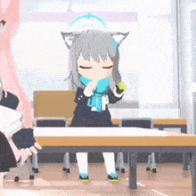
          <h1>🌟 Welcome to My First Web 🌟</h1>
          
Dibuat oleh LeafZuya (Daffa) 😎🤭

          
🍀

          
✨

          
💙

        </header>

        <!-- JAM DIGITAL -->
        

          

            

              00:00
            

            

              
00

              
AM

            

            

          

        

        <!-- BUBBLES -->
        

        

        

        

        

        <main class="container">
          

            <!-- Card: Tentang -->
            

              <h2>✨ Tentang 🍀</h2>
              
Website ini dibuat cuma buat have fun aja, bukan serius. Jadi enjoyyy 😙

              
Kirim kritik dan saran kalian ke <a href="mailto: kingglafeon@gmail.com">Gmail Ku [LeafZuya(Daffa)]....hehehe...🥳</a>

              

                <a href="https://trakteer.id/leafzuya%28daffa%29" target="_blank">
                  <button style="background: linear-gradient(135deg, #ff4e50, #f9d423); border: none; padding: 15px 35px; border-radius: 40px; color: white; font-size: 1.2rem; font-weight: bold; cursor: pointer; box-shadow: 0 5px 15px rgba(0,0,0,0.2); transition: all 0.3s ease;">
                    🍵 Bagi yang mau Traktir......buat Beli Laptop ♥️🥳
                  </button>
                </a>

                <button onclick="playMusic('Jokowi.mp3')">Jangan Pencet Aku....☠️🗿</button>
                <audio id="audio1" src="Jokowi.mp3"></audio>

                <button onclick="playMusic('gok.mp3')">Jangan Pencet Aku....☠️🗿v2</button>
                <audio id="audio2" src="gok.mp3"></audio>

                
                <b>JANGAN COBA-COBA SCREENSHOOT CODE QR DIBAWAH INI,LALU MEMINDAI NYA DI PEMINDAI QR CODE 🗿☠️💀</b>
                
              

            

            <!-- Card: Quiz Kemerdekaan -->
            

              <h2 style="text-align:center; color:#000; font-weight:bold;">🇮🇩QUIZ SPESIAL HARI KEMERDEKAAN (Limited Event)🔥</h2>

              

                

                  
                

                <audio id="frameSound" src="IDN.mp3"></audio>
                
              

              

                
              

              

                <b>"🇮🇩 'Bangsaku yang tercinta, janganlah kamu lupa pada sejarah perjuanganmu. Karena dari sanalah kita belajar untuk terus maju.'"</b> 
                <b>~By:LeafZuya</b>
              

              
Gass Aja Mainin,bakal Di Tutup saat <b>25 Agustus 2026</b> Awokawokawok

            

            <!-- Card: Donasi Palestina -->
            

              <h2 style="text-align:center; color:#000; font-weight:bold;">🇵🇸 Donasi Untuk Palestina</h2>

              

                

                  
                

                <audio id="frameSound2" src="Free.mp3"></audio>
                
              

              

                
              

              

                Bantu saudara-saudara kita di Palestina yang sedang mengalami krisis kemanusiaan.
                Sepeser Bantuan kecil dari kalian dapat memberi dampak besar bagi mereka.
                🇵🇸💚 Terima kasih untuk kebaikan hati kalian. 
                <b>~By:LeafZuya</b>
              

              
Nanti Kalian Akan Diarahkan Ke <b>WEBSITE/SITUS RESMI DAN AMAN</b> untuk Menyumbangkan Amal Sumbangan...Jadi Uang-Nya Tidak Masuk Ke <b>REKENING PRIBADI-KU</b> Yahh!!...

            

            <!-- Card: Pelajaran -->
            

              <h2>📘 Pelajaran Favorit</h2>
              
Matematika & Informatika 💚💙 Karena Melatih Berpikir Kritis dalam menyelesaikan Sesuatu Masalah...!!!!! hehe...gak jelas ah...

            

            <!-- Card: Hobi -->
            

              <h2>🎮 Hobi 🎶</h2>
              
Main game, coding iseng-iseng, dan punya mimpi jadi Indie GameDev 🥳🤞

            

            <!-- Card: Video -->
            

              <h2>📺 Video Random</h2>
              <iframe width="220" height="220" src="https://www.youtube.com/embed/hyd8vfuQta0"
                title="YouTube video player" frameborder="0"
                allow="accelerometer; autoplay; clipboard-write; encrypted-media; gyroscope; picture-in-picture" allowfullscreen></iframe>

              <iframe width="220" height="220" src="https://www.youtube.com/embed/nhUVc_9ki44"
                title="YouTube video player" frameborder="0"
                allow="accelerometer; autoplay; clipboard-write; encrypted-media; gyroscope; picture-in-picture" allowfullscreen></iframe>
            

            <!-- Card: Karya Danang -->
            

              <h2>Penasaran Karya Danang...?, Klik Dibawah Ini ya...!😋</h2> 
              <a href="https://leafzuya.github.io/Khusus_Danang/">Klik aku untuk melihat berbagai Karya Buatan Danang.....😆</a> 
              <a>Jangan Lupa Follow Akun Media Sosialnya...!!</a> 
              <a href="https://tiktok.com/@zainaki_and_hoshino">Media Sosial Danang </a>
            

            <!-- TIC TAC TOE -->
            

              <h2>🎯 Tic-Tac-Toe — Player vs AI</h2>
              
Pilih sisi & tingkat kesulitan, lalu kalahkan AI kalau bisa 😎

              

                <label> Kamu main:
                  <select id="ttt-side" style="padding:6px 10px; border-radius:10px; border:1px solid #9acdff;">
                    <option value="X">❌ X</option>
                    <option value="O">⭕ O</option>
                  </select>
                </label>
                <label> Kesulitan:
                  <select id="ttt-difficulty" style="padding:6px 10px; border-radius:10px; border:1px solid #9acdff;">
                    <option value="easy">Easy</option>
                    <option value="medium">Medium</option>
                    <option value="hard">Hard</option>
                    <option value="impossible" selected>Impossible 😈</option>
                  </select>
                </label>
                <button id="ttt-new">🔁 New</button>
                <button id="ttt-undo">↩️ Undo</button>
                <button id="ttt-hint">💡 Hint</button>
              

              

              

              
Status: siap!

              
Skor — Kamu: 0 | AI: 0 | Seri: 0

              
            

            <!-- Card: Tangkap Emoji -->
            

              <h2>Tangkap Emoji....!!😎🥳😵</h2>
              
dibawah ini,hanya Ilustrasi gambar...jadi,percuma Di-Klik² berapa kali pun 

              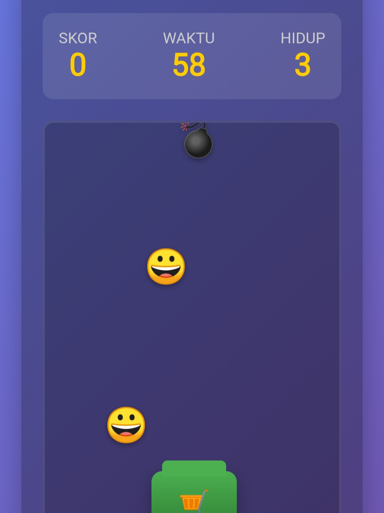
              <a href="https://leafzuya.github.io/Web-Have-Fun-/">Klik aku untuk Mainkan...!!!,Kalo kalah, Berarti Noob😎☝️</a>
              
Cara mainnya tinggal di Klik ke kanan atau ke kiri aja,lalu tangkap semua dan kumpulkan point sebanyak-banyaknya.....!!!(Hanya disediakan 3 Nyawa/Kesempatan)

            

            <!-- Card: Sound Memory -->
            

              <h2>Sound Memory....!!🗣️🎤🎧</h2>
              
dibawah ini,hanya Ilustrasi gambar...jadi,percuma Di-Klik² berapa kali pun 

              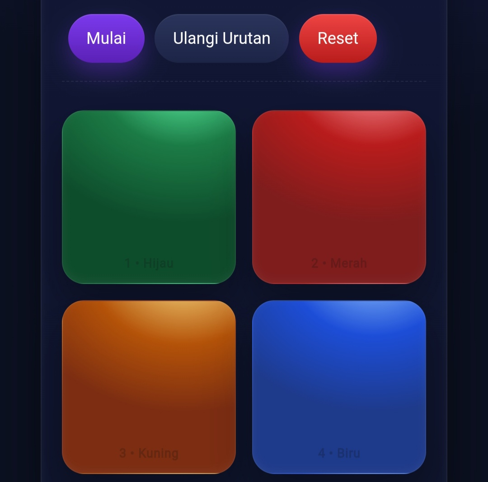
              <a href="https://leafzuya.github.io/Sound-Memori-/">Klik aku untuk Mainkan sound memori...!!!,Kalo cepat kalah, Berarti jangan main ini lagi,main sana game Roblox 🤓☝️</a>
              
Cara mainnya tinggal ikuti irama yang muncul acak dan pencet tombol sesuai irama yang muncul pada tombol tersebut.....semakin lama akan semakin banyak irama yang akan di putar/mainkan..... Semangat....!!!🥳♥️🔥

            

            <!-- Card: Kalkulator -->
            

              <h2>Kalkulator LeafZuya 😆🌿➗➖➕</h2>
              
dibawah ini,hanya Ilustrasi gambar...jadi,percuma Di-Klik² berapa kali pun 

              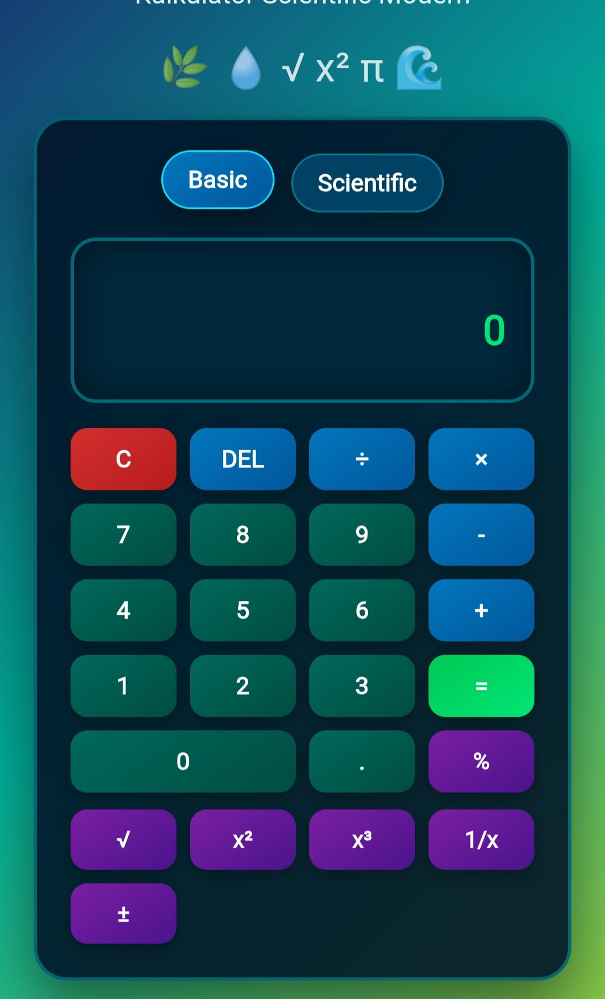
              <a href="https://leafzuya.github.io/Kalkulator-/">Klik aku untuk Menjalankan Kalkulator,versi Buatan ku sendiri.....</a>
              
Konon katanya,orang yang menggunakan Kalkulator Ini,bisa menambahkan IQ Manusia Maksimal sampai 105....🗿👍

            

            <!-- Card: LeafCy AI -->
            

              <h2>LeafCy AI😆🌿</h2>
              
dibawah ini,hanya Ilustrasi gambar...jadi,percuma Di-Klik² berapa kali pun 

              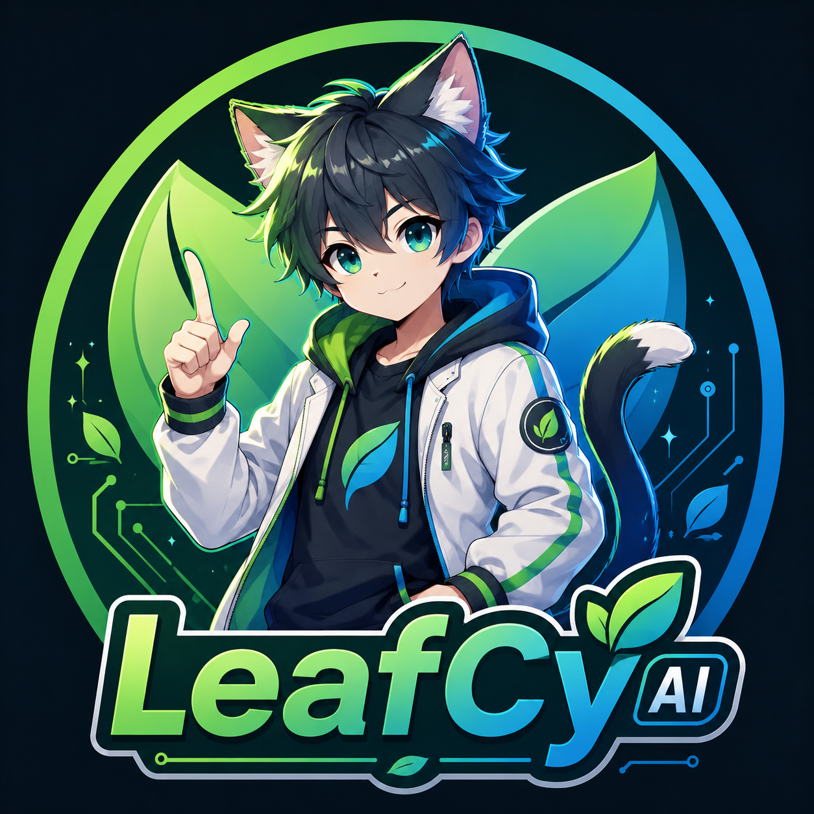
              <a href="https://leafcyai.my.id/" class="magic-btn">Kunjungi LeafCy AI☘️😆</a>
              
Jangan Lupa Klik Tombol Diatas yah....Itu adalah AI Buatan ku Sendiri (LeafZuya),tapi masih Tahap Pengembangan (Beta)...kalian juga bisa Tambahkan Obrolan dan Jawaban Obrolan Nya...[LeafCy AI X OpenRouter]😆🤞☘️🍃

            

            <!-- Card: Leaf-Wheel -->
            

              <h2>Leaf-Wheel🎡🌿</h2>
              
dibawah ini,hanya Ilustrasi gambar...jadi,percuma Di-Klik² berapa kali pun 

              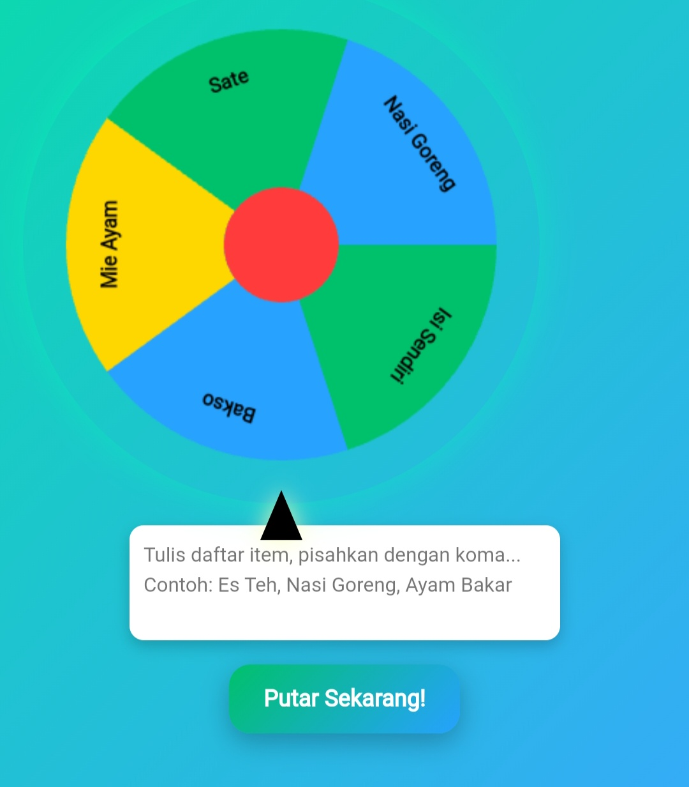
              <a href="https://leafzuya.github.io/Leaf_Wheel/" class="magic-btn">Kunjungi Leaf-Wheel☘️🎡</a>
              
Butuh Roda Penentu Keberuntungan???, Cobain Leaf-Wheel Yukkk!!!!🗿🙏☘️🎡

            

            <!-- Card: Cek Hewan -->
            

              <h2>Cek Hewan Dalam Jiwa Kalian!!🌿</h2>
              
dibawah ini,hanya Ilustrasi gambar...jadi,percuma Di-Klik² berapa kali pun 

              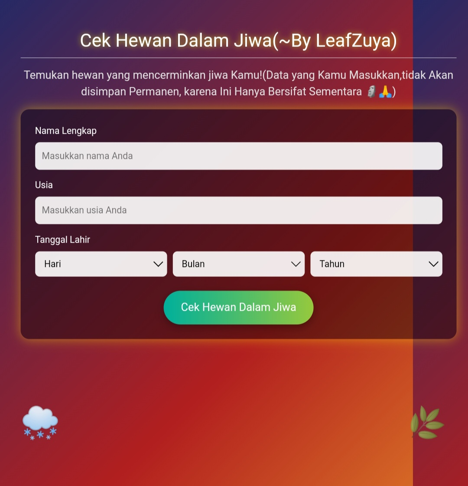
              <a href="https://leafzuya.github.io/Cek-Hewan-/" class="magic-btn">Kunjungi Cek Hewan Dalam Jiwa ☘️✅🗿</a>
              
Apakah Kalian Sering Bertanya Dalam Hati"Sebenarnya, Apasih Hewan/Khodam Dalam Diri ku ini?"...Nahh,untuk itu, Kunjungi Minigame Diatas,untuk Memecahkan Rasa Penasaran Kamu...🗿🙏☕

            

            <!-- Card: LeafPy -->
            

              <h2>LeafPy!🐦🌿</h2>
              
<b>Dibawah ini Hanya Gambar Ilustrasi saja!!</b>

              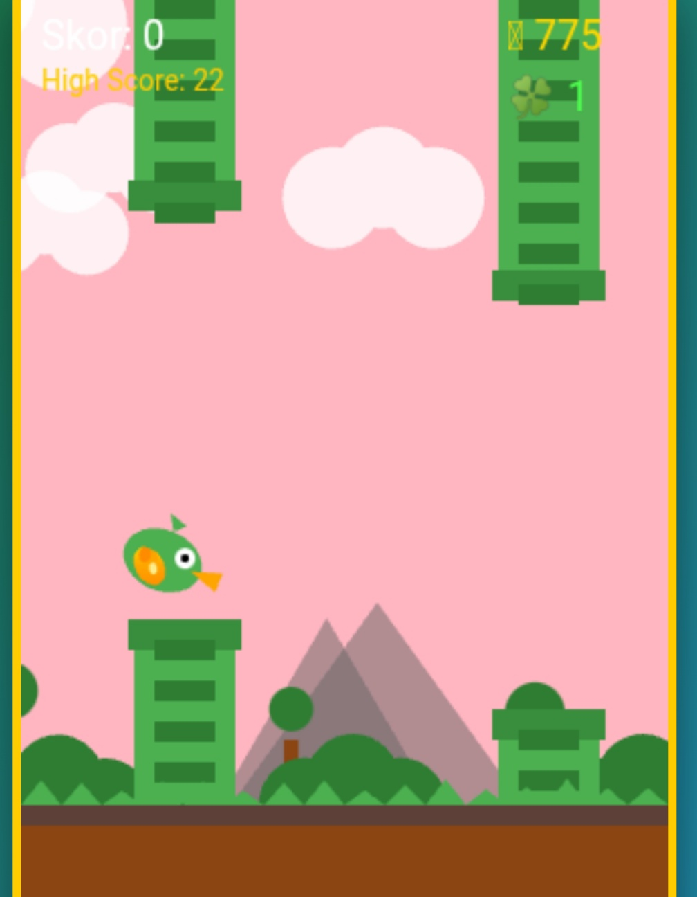
              <a href="https://leafzuya.github.io/LeafPy/" class="magic-btn">Game Burung Santai, selamat Bermain  ☕🗿🍃🐦</a>
              
Kalian Suka Tantangan Skor Paling Banyak Dengan Orang lain Di Seluruh Dunia???,Nahhh...kalian Datang Di tempat yang Tepat,Di LeafPy,Kalian Bisa Mengumpulkan Skor sebanyak-banyaknya dengan cara melewati Rintangan Pipa Merah!!!, Minigame Ini juga Dilengkapi Leaderboard Online Mengandalkan Server Storage Browser....(Butuh Waktu 4 Minggu Woilah Baru Selesai 🗿🙏☕)

            

            <!-- Card: LeafFast -->
            

              <h2>Uji Kekuatan Kecepatan Jari!🌿</h2>
              
dibawah ini,hanya Ilustrasi gambar...jadi,percuma Di-Klik² berapa kali pun 

              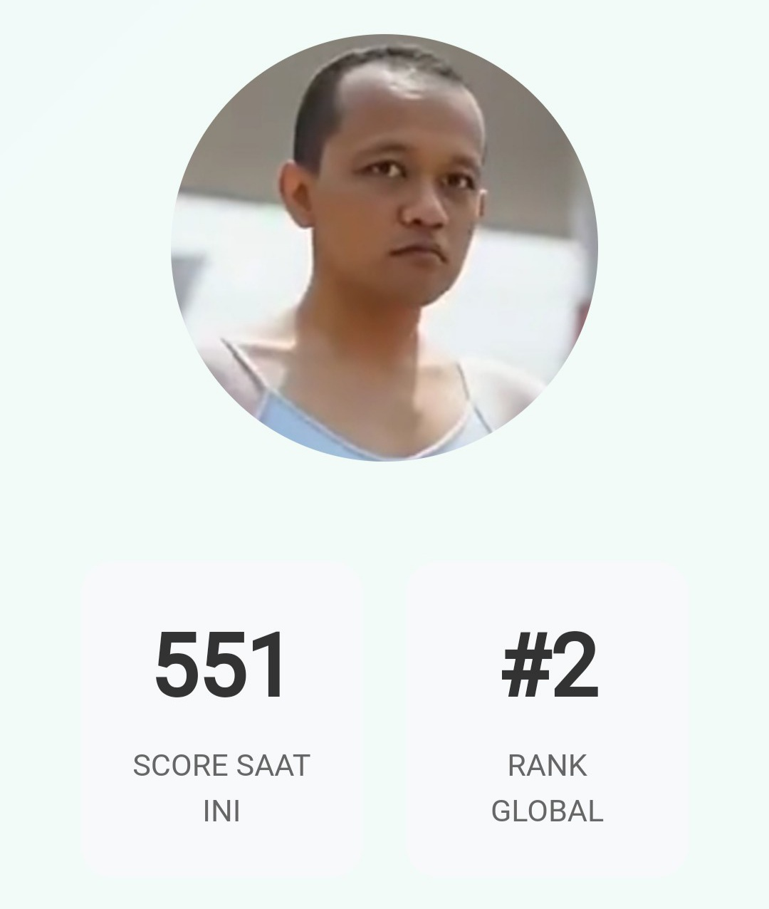
              <a href="https://leafzuya.github.io/LeafFast/" class="magic-btn">Kunjungi LeafFast ☘️✅🗿</a>
              
Apakah Kalian Mempunyai Kekuatan Kecepatan Super???,Kalo iya,buktikan Dengan Memainkan Minigame ini🗿🙏☕

            

            <!-- Card: Leaf Flip -->
            

              <h2>Uji Ingatan Otak!🌿</h2>
              
dibawah ini,hanya Ilustrasi gambar...jadi,percuma Di-Klik² berapa kali pun 

              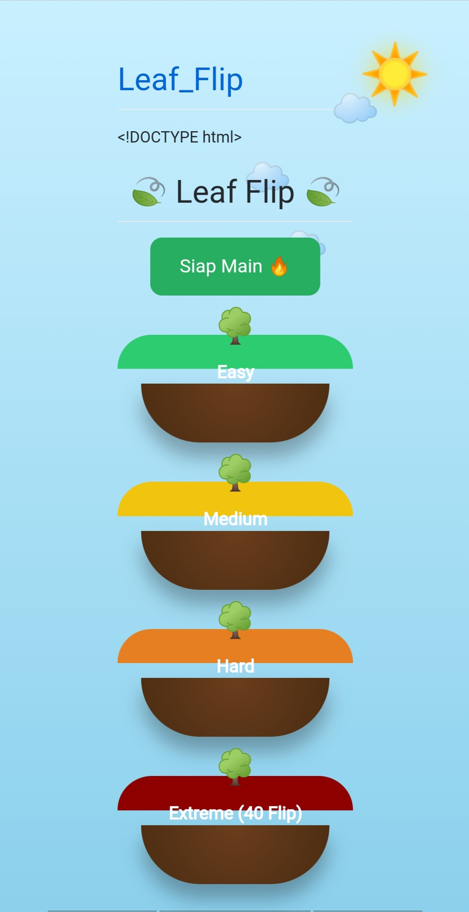
              <a href="https://leafzuya.github.io/Leaf_Flip/" class="magic-btn">Mainkan Supaya Punya IQ tinggi!☘️🗿</a>
              
Ingin Punya Ingatan Super???,Ingin Punya IQ Tingi???,Nahh...Mainkan Lah,Minigame Ini!🗿🙏☕

            

            <!-- Card: Sneaky -->
            

              <h2>Sneaky!🌿🗿</h2>
              
dibawah ini,hanya Ilustrasi gambar...jadi,percuma Di-Klik² berapa kali pun 

              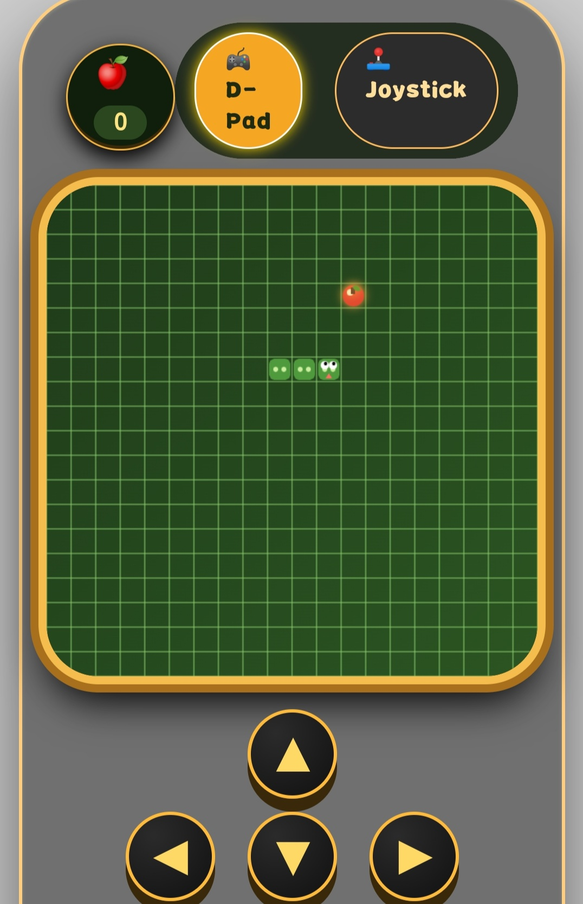
              <a href="https://leafzuya.github.io/Sneaky/" class="magic-btn">Mainkan Sneaky! ☘️🗿</a>
              
Game Gabut Final Bos,Tema Nostalgia+Jadul,tapi Dengan Nuansa Dan Fitur Modern!🗿🙏☕

            

            <!-- Card: ReflexZ -->
            

              <h2>ReflexZ😆🌿</h2>
              
dibawah ini,hanya Ilustrasi gambar...jadi,percuma Di-Klik² berapa kali pun 

              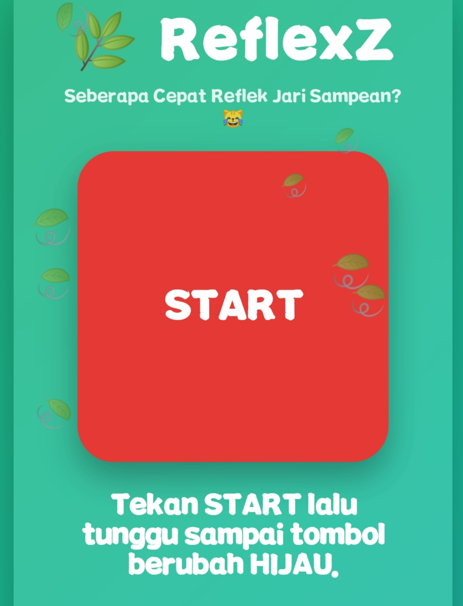
              <a href="ReflexZ.html" class="magic-btn">Kunjungi ReflexZ!😆</a>
              
Gas Aja Mainin,ga Usah Basa-Basi🤞🍃

            

          

        </main>

        <!-- ABOUT PAGE -->
        <section id="aboutPage" class="about-page">
          

            <h2>🌿 LeafZuya Web Have Fun</h2>
            

              Website ini dibuat sebagai hiburan Di Waktu Luang,Jangan Terlalu Fokus/Serius pada Website ini,Hidup kalian lebih berwarna,jika kalian melakukan Hal-Hal yang Bermanfaat untuk Orang lain dan Diri Sendiri...Ingat!,kita Ini Makhluk Yang Lemah!,Jangan Sombong kepada sang Pencipta!,Karena Dialah yang Berkuasa atas Dunia Ini,dan Jangan Lupa <b>BERBUAT BAIK</b> 💚.
            
 

            
Website Ini Dipercayai Oleh 150+ Orang² Gabut dari Seluruh Dunia,dan Diawasi Oleh Organisasi Perkumpulan Orang² Gabut Se-Asia Tenggara(OPO2GAT)

            <ul>
              <li>Dibuat Sejak:10 Agustus 2025
                <li><b>🧩 Versi:</b> v17.8.45— "Blood Leaves of Struggle🇮🇩🔥"</li>
                <li><b>💬 Dibuat oleh:</b> LeafZuya(Daffa)</li>
            </ul>

            

              ✨ Catatan Developer: 
              "Ubahlah Waktu Luang Kalian Yang Tidak Bermanfaat,Menjadi <b>SEDIKIT</b> lebih Bermanfaat"
            

            <li><b>📅 Update terakhir:</b> 16 Agustus 2026</li>
            <h1> •Apa Yang Baru?</h1>
            
-Memperbaiki Bug

            
-Mengubah Deskripsi dan Gambar Ilustrasi LeafCy AI

            
-Update LeafCy AI,Jadi Punya Logikanya Sendiri!!😆

            
-Update LeafCy Jadi Punya Akselerasi buat Mengetik "Zuya Ganteng 😎 " Sebanyak 1000x,Untuk Me-Redeem Pengurangan Waktu Selama 30 Menit🗿🙏

            <button id="backBtn" class="btn-back">⬅️ Kembali</button>
          

        </section>

        <!-- FOOTER -->
        <footer>
          © 2025 Fun Web by LeafZuya. Jangan Copyright...!! dan Jangan Lupa
          <b>BERNAFAS</b> 🤭🗣️🔥 
          🍀
          💚
          💙
        </footer>
      

    

  

  <!-- SCROLL TO TOP -->
  <button class="scroll-top-btn" id="scrollTopBtn" title="Kembali ke atas">⬆️</button>

  <!-- ============ SCRIPT: SIDEBAR, THEME, NAV ============ -->
  

  <!-- ============ SCRIPT LOADING SCREEN (ASLI) ============ -->
  

  <!-- ============ SCRIPT JAM DIGITAL (ASLI) ============ -->
  
</body>
</html>
